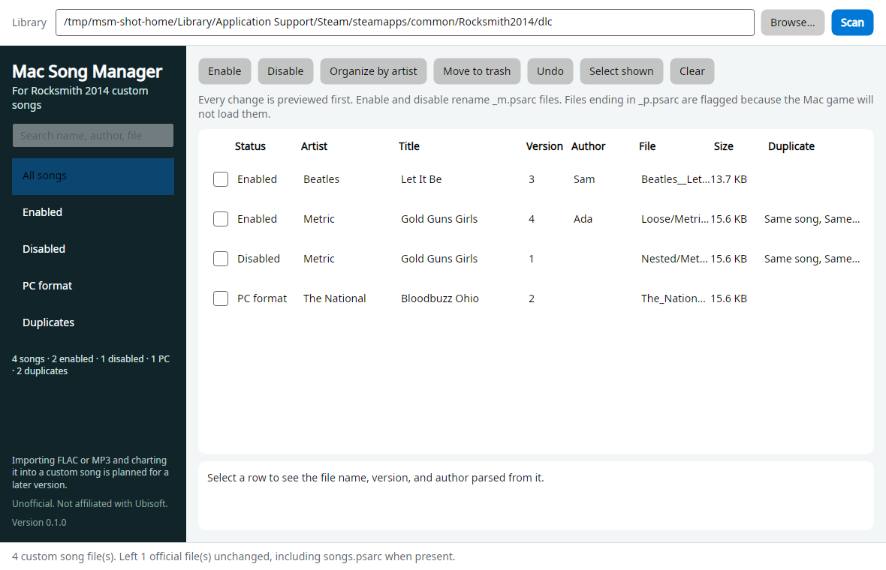
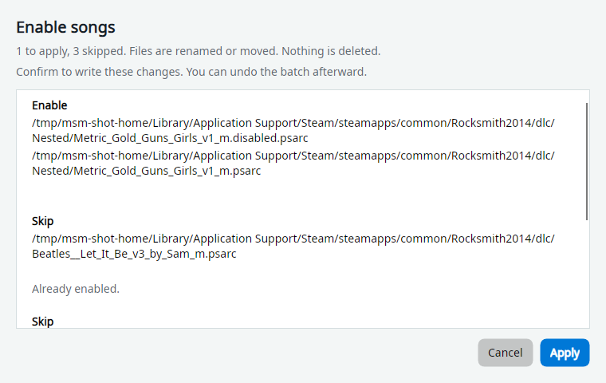

# Mac Song Manager

Mac Song Manager is a small Mac app for Rocksmith 2014 custom songs. It lists the files in your `dlc` folder, renames them to enable or disable them, groups them into artist folders, and points out duplicates.

It is unofficial and is not affiliated with Ubisoft or CustomsForge. The program is licensed under GPL-3.0-or-later.

Library tags come from file names. PC-to-Mac conversion opens a package only to swap the platform layout, using code adapted from glebb's rocksmithconvert. See NOTICE.





## What it does

- Starts in `~/Library/Application Support/Steam/steamapps/common/Rocksmith2014/dlc`. You can pick another folder. Subfolders are included.
- Lists `*_m.psarc` as enabled and `*_m.disabled.psarc` as disabled.
- Flags `*_p.psarc` and `*_p.disabled.psarc`. Converting them is off until you turn on **Convert PC custom songs**. That writes a new file under `dlc/converted-from-pc/` as `*_m.psarc` and leaves the PC file in place. A song that already has a Mac file is skipped. `songs.psarc`, compatibility packs, and any package without a `toolkit.version` custom-song marker are refused. The conversion keys are not in the app. Choose a keys file in the sidebar, or save one as `~/Library/Application Support/Mac Song Manager/conversion-keys.txt`. The names to fill in are `tocKey`, `tocIV`, `sngMac`, and `sngPC`. An empty template is `packaging/conversion-keys.example.txt`.
- Parses artist, title, version, and author from CamelCase hyphen names (`Creed-OneLastBreath_m.psarc`), `Artist - Title`, and `Artist_Title_v1_DD` names. Low-confidence names are marked for review.
- Lets you edit artist and title. Edits are stored in the app's tag file, not inside the song file. Fix tags can ask MusicBrainz, one request per second, and you accept each suggestion.
- Renames files to `Artist - Song Title_m.psarc`, keeping `_m` or `_m.disabled`.
- Searches, filters, and sorts the list.
- Enables or disables Mac files by renaming `_m.psarc` and `_m.disabled.psarc`, including a selection of files.
- Moves files into an artist subfolder, after a preview.
- Finds duplicates with the same normalized artist and title, and files with the same SHA-256 hash.
- Leaves official game files alone. `songs.psarc`, `gears.psarc`, and compatibility packs are not listed and cannot be renamed.

## File names

After the platform suffix, these shapes are recognized:

| File name | Artist | Title | Version | Author |
| --- | --- | --- | --- | --- |
| `Artist_Title_v1_m.psarc` | Artist | Title | 1 | |
| `Artist_Title_v1_by_Ada_Lovelace_m.psarc` | Artist | Title | 1 | Ada Lovelace |
| `Metric - Gold Guns Girls_v4_m.psarc` | Metric | Gold Guns Girls | 4 | |
| `The_Rolling_Stones__Paint_It_Black_v2_m.psarc` | The Rolling Stones | Paint It Black | 2 | |

A single hyphen splits `Creed-OneLastBreath` into artist and title, then splits CamelCase, digits, and small words such as of, the, and van. `Artist_Title_v1_DD_m.psarc` and `Artist - Title` are read too. `1979_m.psarc` and `babaoriley_m.psarc` use a small built-in list of official short names. Other names without a separator are marked low confidence until you edit them or accept a MusicBrainz suggestion.

Duplicate matching ignores punctuation, accents, and a leading "The".

## Credits

Original application code, copyright 2026 Antony Vo, GPL-3.0-or-later.

PC-to-Mac conversion is adapted from [rocksmithconvert](https://github.com/glebb/rocksmithconvert) by glebb, GPL-3.0-or-later. The C# port follows the macOS sources `Crypto.swift` (table cipher and chart re-key), `Platform.swift`, and `Converter.swift`. The archive table reader and writer began as a port of [pyrocksmith](https://github.com/0x0L/rocksmith) by 0x0L, MIT. Both were rewritten in C# in 2026. The port converts PC custom songs to Mac: it re-keys chart entries and updates aggregate-graph paths. Keys are read from a file you supply. Details and the MIT notice are in `NOTICE`.

The window UI uses [Avalonia](https://github.com/AvaloniaUI/Avalonia), MIT.

## Install

Download `MacSongManager-0.1.0-osx-arm64.zip` on Apple silicon, or the `osx-x64` zip on Intel. Unzip it and move `Mac Song Manager.app` to Applications.

The build is unsigned and not notarized. macOS may block the first open. Right-click the app, choose **Open**, then confirm. Or, in Terminal:

```bash
xattr -dr com.apple.quarantine "/Applications/Mac Song Manager.app"
```

The zip is large because the .NET runtime is inside the app. You do not install a separate runtime.

## Usage

1. Open Mac Song Manager. It scans the Steam `dlc` folder when that folder exists.
2. Use **Browse…** if your songs live somewhere else, then **Scan**.
3. Filter the list, or search by name, author, file, or hash.
4. Tick the songs you want to change. **Select shown** ticks the rows that match the current search.
5. Choose Enable, Disable, Organize by artist, or Move to trash.
6. Read the preview. **Apply** renames or moves the files and writes an undo entry. **Cancel** writes nothing.
7. **Undo** reverses the latest batch, again after a preview.

Disabled files stay in the folder. The game skips names that end in `_m.disabled.psarc`. Enable renames them back.

Organize uses the artist parsed from the file name. A file already in that folder is left there. `AC/DC` becomes a folder named `AC DC`.

Move to trash places the file in `~/Library/Application Support/Mac Song Manager/Trash` on a Mac. Undo moves it back. The app has no delete command.

PC files can be filed into an artist folder or moved to trash. They cannot be enabled, because renaming `_p` to `_m` would not make them load.

## Safety

- Song files are renamed or moved. They are not deleted.
- Each applied batch is appended to `change-log.jsonl` next to the trash folder. Undo replays that batch in reverse.
- A failed batch moves completed files back before it returns.
- The preview is the dry run. Nothing is written until you choose Apply.
- Writes stay inside the chosen library folder, except a move into the app trash folder.
- Symlinks that point outside the library are skipped.
- `songs.psarc`, `gears.psarc`, and file names containing `compatibility` are refused even if a preview is forced.
- PC-to-Mac conversion is off by default. Turn it on only for custom songs. Packages without `toolkit.version`, and packages that still look like official Ubisoft content, are refused.
- Point the library at the `dlc` folder, not at the game itself.

## What this version does not do

- The song list does not show arrangements or an in-package key. Artist and title come from the file name, your edits, or MusicBrainz.
- It does not sync a song catalog with a website. Fix tags is a MusicBrainz search you start yourself.
- It does not import FLAC or MP3. That seam is still unused. See [docs/roadmap.md](docs/roadmap.md).

## Build from source

Requires the .NET 10 SDK.

```bash
git clone https://github.com/voantony/rocksmith-song-manager-mac.git
cd rocksmith-song-manager-mac
./eng/test.sh
./packaging/assemble-macos-app.sh osx-arm64
./packaging/assemble-macos-app.sh osx-x64   # optional Intel build
```

`./eng/test.sh` runs the unit tests and fails if source files contain publisher decryption constants or long embedded hex strings. GitHub Actions runs that script on macOS, builds both app bundles, and uploads the zips. A `v*` tag also publishes a GitHub Release.

## Roadmap

Audio import is still only a seam. PC-to-Mac conversion of custom songs is included, off by default, and described above.

## Credits

See the credits section above. `THIRD_PARTY_NOTICES.md` lists the UI toolkit.

## Disclaimer

Mac Song Manager is an unofficial tool for Rocksmith 2014 custom songs. It is not affiliated with, endorsed by, or supported by Ubisoft or CustomsForge. Rocksmith is a trademark of its owner. You are responsible for the song files you store in the `dlc` folder.

## License

GPL-3.0-or-later. See `LICENSE`.
